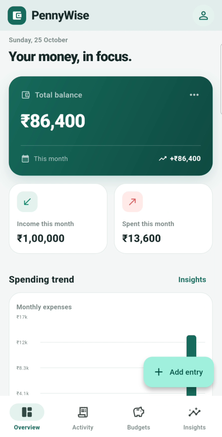

# PennyWise — Personal Finance Tracker

PennyWise is a Flutter personal-finance app for tracking income, expenses, category budgets, and spending trends. It is built as an offline-first Android app with local SQLite storage.

> Portfolio project: the dashboard screenshot may contain demo/sample transactions. Do not use sample totals as real financial data.

## Features

- **Finance dashboard** — current balance, monthly income, monthly expenses, and spending-trend visualization.
- **Transaction management** — add, edit, delete, search, and filter income and expenses.
- **Budgets and analytics** — configure category budgets, review spending progress, and compare spending trends.
- **Offline persistence** — store transactions and budgets locally with SQLite so they remain available after restarting the app.

## Screenshots

Add the app screenshot at `screenshots/dashboard.png` to display it here:



## Built with

- Flutter and Dart
- Riverpod for state management
- SQLite via `sqflite`
- `fl_chart` for data visualizations
- `intl` for date and number formatting

## Run locally

### Prerequisites

- Flutter SDK (stable channel)
- Android SDK / Android Studio or another configured Android device

### Setup

1. Clone or download this repository.
2. Open the project root (the directory containing `pubspec.yaml`) in VS Code.
3. Install dependencies:

   ```bash
   flutter pub get
   ```

4. Check the project:

   ```bash
   flutter analyze
   flutter test
   ```

5. Start an Android emulator or connect an Android device, then run:

   ```bash
   flutter run
   ```

## Project structure

```text
pennywise_tracker/
├── lib/
│   ├── data/          # SQLite database access
│   ├── models/        # Transaction model
│   ├── providers/     # Riverpod state/controller logic
│   ├── screens/       # Dashboard, activity, budgets, analytics
│   ├── theme/         # App colors and theme
│   └── widgets/       # Transaction and budget forms, reusable widgets
├── test/              # Automated tests
├── pubspec.yaml       # Dependencies and package configuration
└── README.md
```

## Verification

The project was run on an Android device. The author manually checked transaction operations, budget/analytics flows, and persistence after restarting the app. `flutter test` passed during the setup workflow. Run the commands above on your environment to verify your checkout.

## Future improvements

- CSV export and import
- Recurring transactions and scheduled budgets
- Optional account sync and backup
- More automated widget and database integration tests
- Accessibility and additional screen-size checks

## Author

Hemanth Gandhi Muppalla

GitHub: [hemanth7099](https://github.com/hemanth7099)
